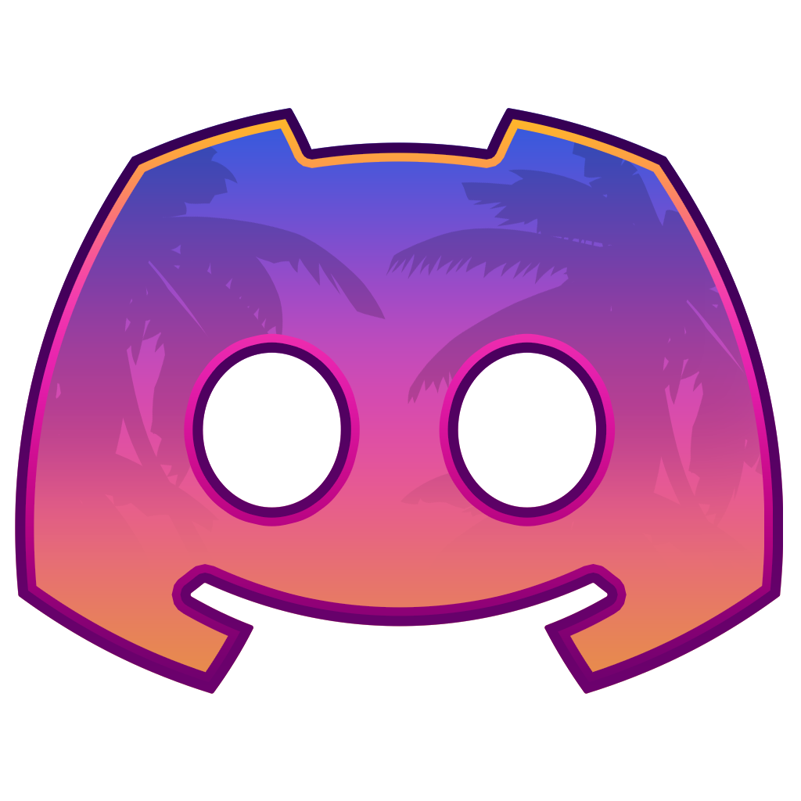
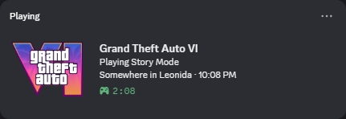

<h1 align="center">
  <br>
  <a href="https://github.com/c4k3ss/GTA-VI-RPC"></a>
  <br>
  GTA VI RPC
  <br>
</h1>

<h4 align="center">Discord Rich Presence for GTA VI on PC</h4>

<p align="center">
  <a href="#key-features">Key Features</a> •
  <a href="#upcoming">Upcoming</a> •
  <a href="#how-to-use">How To Use</a> •
  <a href="#download">Download</a> •
  <a href="#how-it-works">How It Works</a> •
  <a href="#for-layer-developers">For Layer Developers</a> •
  <a href="#building-from-source">Building From Source</a> •
  <a href="#license">License</a>
</p>

<p align="center"></p>

## Key Features

* **Works with every VIctory-based build** - VIctory, victory-fork, Belobug, DexNom, AvatarManz, CGBJ, Flamingo, VItoriaBr and their forks
* **Live game state** - Menus, loading and the world, with the in-game clock read from the game itself
* **Conditional** - Shows up when the game is running, clears when it closes
* **Nothing touched** - No injection, no patches, no game files; it reads the layer's window and the game's memory
* **Auto-update** - Fetches new releases itself (on start and every six hours; `auto_update = false` turns it off)
* **Lightweight** - One small exe, nothing to configure, no runtime to install

## Upcoming

* Street and area from the game itself ("Standing near Port Gelhorn")
* System tray icon
* Other layers (XCL) and other game builds

## How To Use

Run `vi-rpc.exe`, play... done! Start it before or after the game; the presence appears once the game runs and clears when it closes. No account, no setup: the Discord application is the project's own.

> **Note**
> A layer's launcher can start it for you: add `start "" "C:\path\to\vi-rpc.exe" --exit-with-game` above the `victory.exe run ...` line; with that flag it quits when the game does.

To use your own Discord application instead (your name and art), put `vi-rpc.toml` next to the exe with `app_id = "<your application id>"`; see `vi-rpc.example.toml`.

## Download

You can [download](https://github.com/c4k3ss/GTA-VI-RPC/releases) the latest version for Windows.

**Requirements:** Windows 10/11, Discord running on your PC, a VIctory-based layer.

## How It Works

The layer names its window `<title> | VIctory <fps> fps <ms> ms/frame <draws> draws/frame`; the draw count tells menus from the world. For a known game build, a few values are read from the running process: the clock (day, month, year, hour, minute, second) and the camera position, at fixed offsets in the game's image. The offsets are keyed by the build's hash, which the layer puts in the image's module name, so other builds can be added in `src/title.rs`.

The same exe contains the scanner that found those offsets (`vi-rpc clock`, `scan`, `snap`, `diff`, ...). The scripts in `tools/` drive it; `PLAN.md` has the notes.

## For Layer Developers

Three ways to support it, from nothing to full:

1. **Bundle it.** Ship `vi-rpc.exe` next to your launcher and start it before the game: `start "" vi-rpc.exe --exit-with-game` in a batch file, or `Command::new("vi-rpc.exe").arg("--exit-with-game").spawn()` in Rust. It runs once at a time and quits with the game. It updates itself from this repository's releases, so you never rebuild for it. Make it opt-in or opt-out as you prefer.
2. **Keep the window title.** All the tool needs from the layer is the title `<name> | VIctory <fps> fps <ms> ms/frame <draws> draws/frame`. Keep that format and you are supported.
3. **Tell it more.** Things the layer knows (the scene, the mission, the street) can go into `%LOCALAPPDATA%\vi-rpc\state.json`, rewritten whenever they change; the tool prefers that file over its own readings. Fields, all optional:
   ```json
   { "scene": "world", "mission": "Gone Fishing", "street": "Sunset Dr", "area": "Key Lento", "activity": "driving" }
   ```
   `mission` replaces "Playing Story Mode"; the others make the second line. A file older than ten minutes is ignored.

## Building From Source

```bash
# Prerequisites: Rust (stable), Windows

git clone https://github.com/c4k3ss/GTA-VI-RPC.git
cd GTA-VI-RPC
cargo build --release
# target\release\vi-rpc.exe
```

## License

[MIT](LICENSE). VIctory and its forks are GPL-3.0; this tool contains none of their code.
